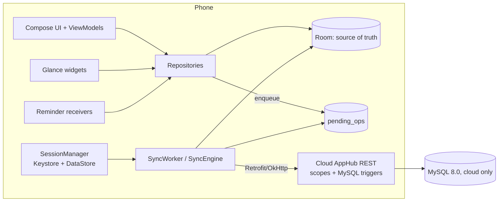

# Architecture Proposal — Shopping List (Phase 0)

Date: 2026-11-15 · Status: **proposal, awaiting approval; no code exists** · See [PROJECT_AUDIT](PROJECT_AUDIT.md), [APPHUB_FEASIBILITY](APPHUB_FEASIBILITY.md), [IMPLEMENTATION_PLAN](IMPLEMENTATION_PLAN.md)

Principles: native Android; **Room is the source of truth**; the cloud (AppHub) is a replica that is only ever reached through the sync layer; guests never need an account; collaboration is enforced on the server (see feasibility §5–6), never only in Android; no abstraction without a present need.

---

## 1. System context



- No other backend, no Firebase, no analytics or ad SDKs.
- Local-only (guest) data never leaves the device unless the user explicitly migrates it.
- The database exists **only in the cloud AppHub** (a dev app for tests, a production app for release). There is no local server database.

## 2. Module and package structure

**One Gradle module (`:app`) with enforced package boundaries.** Splitting into Gradle modules now adds build time, Hilt/KSP wiring and navigation plumbing for a small app; the package layout below lets us extract `:core-data` or `:feature-*` later without rewrites. (Decision to confirm.)

```
space.abhijithkm.shoppinglist
  App.kt                         Application, Hilt entry, WorkManager config, notification channels
  di/                            Hilt modules (DatabaseModule, NetworkModule, SyncModule, ...)
  core/
    model/                       pure Kotlin domain types (ShoppingList, Item, Member, Invitation, Role, SyncState)
    util/                        Clock, IdGenerator (UUIDv4), Result/AppError, DebounceRunner
    security/                    KeystoreCipher, CodeGenerator (SecureRandom, 32-symbol alphabet)
  data/
    local/                       Room: entities, DAOs, AppDatabase, migrations, converters
    remote/                      AppHub: api (Retrofit), dto, mappers, error mapping, AuthInterceptor/Authenticator
      AppHubAuthService          register/login/logout/refresh/me/access
      AppHubShoppingListService  lists, categories, tags (+ item_tags)
      AppHubItemService          items (revision-aware PATCH, delta pull)
      AppHubSharingService       lookups, invitations, codes, join requests, commands
    repository/                  LocalShoppingRepository (UI-facing, Room + enqueue)
                                 RemoteShoppingRepository (sync-facing, AppHub only)
                                 SessionRepository, SettingsRepository (DataStore)
    sync/                        SyncManager, PushEngine, PullEngine, ConflictResolver, SyncWorker, MigrationWorker
  feature/
    lists/ (home)   listdetail/   categories/   sharing/   invitations/   settings/   auth/   migration/
  widget/                        Glance widgets, config activity, ActionCallbacks, QuickAddActivity
  reminders/                     ReminderScheduler, receivers (Alarm, Boot, TimeChange), notifier
  ui/theme/                      Material 3 theme, components, shared composables
```

Layering rule: `feature/*` → `data/repository` → (`data/local`, `data/sync`); only `data/sync` and `RemoteShoppingRepository` import `data/remote`. ViewModels never see Retrofit or DTOs. UI never calls AppHub. Names from the master prompt (`AppHubAuthService`, `AppHubShoppingListService`, `AppHubItemService`, `AppHubSharingService`, `SyncManager`, `LocalShoppingRepository`, `RemoteShoppingRepository`) are kept.

Patterns: MVVM; `StateFlow<UiState>` per screen with one-shot events via `Channel`; unidirectional data flow; repository interfaces only where there are two implementations or a test seam (Local/Remote, Clock, IdGenerator). No use-case classes unless logic is shared by 2+ ViewModels.

## 3. Navigation and UX

Bottom `NavigationBar` with three destinations, shown only on top-level screens: **Lists** (home), **Categories**, **Settings**. List details, sharing, join and migration are pushed screens. Invitations and join requests appear as a badge/entry at the top of Lists, not as another tab.

| Screen | Key behaviour |
|---|---|
| **Lists (home)** | Cards: name, icon, colour, total/remaining/done counts, shared badge, last updated; pinned first; search, sort, archive, delete (with undo); prominent FAB; sync/offline banner |
| **List detail** | Inline quick-add row (focus stays after add; `2 kg milk`-style parsing optional later); open items grouped (optionally by category), completed section collapsible and configurable; progress bar; drag-to-reorder (`reorderable`); swipe to delete with undo snackbar; edit sheet for quantity/unit/category/tags/notes; clear completed with undo |
| **Share** | Owner only; "Invite by email" and "Sharing code" tabs; member list with remove; pending invitations/requests with revoke/approve/reject. Hidden for guests; tapping Share as guest opens the sign-in sheet (the *only* time auth is requested) |
| **Join a list** | Enter code → preview (list name, inviter) → Request access → pending state |
| **Invitations** | Accept/reject, pending join requests (as owner), "leave list" in list menu |
| **Categories** | 11 defaults (not DB rows; fixed keys `vegetables`, `fruits`, … `others`) plus custom, rename, colour; filter and group-by in list detail |
| **Settings** | Theme (light/dark/system), show completed, default sort, notification categories, reminders, account (sign in/out, delete account), sync status and "Sync now", data (export/clear), about |
| **Auth sheet** | Sign in / register / forgot password; never blocks guest use |
| **Migration** | After first sign-in: list of local lists with checkboxes, per-list result, retry (see §7) |

Design: Material 3, dynamic colour optional, restrained rounded surfaces, 48 dp targets, content descriptions, light and dark, subtle animations only (item check, list reorder). Copy rule borrowed from ReadRhythm: "Saved" only when the server has it, otherwise "Saved on this phone". Sync state is a small status indicator, never a modal.

## 4. Local data model (Room)

IDs are **client-generated UUIDv4 strings** everywhere (also used as AppHub primary keys, which makes creates idempotent). Timestamps are epoch milliseconds in Room; DATETIME(3) UTC strings on the wire.

Entities (columns abbreviated; every synced entity also has `accountId`, `syncState`, `deletedAt`):

| Entity | Columns |
|---|---|
| `lists` | `id`, `accountId?`, `origin` (`LOCAL`/`CLOUD`), `name`, `description?`, `icon?`, `color?`, `isArchived`, `isPinned`, `sortKey`, `role` (`OWNER`/`EDITOR`), `ownerName?`, `createdAt`, `updatedAt`, `revision`, `serverRevision`, `deletedAt?` |
| `items` | `id`, `listId` FK, `name`, `quantity?` (REAL), `unit?`, `categoryKey?`, `notes?`, `isBought`, `boughtAt?`, `sortOrder` (REAL, gap-based; renumber when gap < 1e-6), `createdBy?`, `updatedBy?`, `createdAt`, `updatedAt`, `revision`, `serverRevision`, `deletedAt?` |
| `categories` | `id`, `listId?` (list-scoped for shared lists), `name`, `color`, `isDefault` |
| `tags`, `item_tags` | `tags(id,listId?,name)`, `item_tags(itemId,tagId,listId)` |
| `members` | `id`, `listId`, `memberId`, `displayName`, `role` (`OWNER`/`EDITOR`/`REMOVED`) |
| `invitations`, `join_requests` | mirrors of cloud rows incl. denormalized `listName`/`inviterName`, `status`, `expiresAt` |
| `pending_ops` | `seq` (autoinc), `opId` UUID **unique**, `accountId`, `entityType`, `entityId`, `opType`, `payload` JSON, `baseRevision?`, `status` (`PENDING`/`SYNCING`/`FAILED`/`CONFLICT`), `attempts`, `nextAttemptAt`, `lastError?`, `createdAt` |
| `sync_state` | `accountId`, `entity`, `cursor` (last seen `updated_at`), `lastSuccessAt`, `lastError?` |
| `reminders` | `id`, `listId?`, `kind` (`SCHEDULED`/`INCOMPLETE`), `schedule` fields, `enabled` |
| `widget_bindings` | `appWidgetId`, `listId` |

Rules:

- **Guest vs cloud separation:** `origin = LOCAL` and `accountId = null` are guest data. They are never uploaded without the migration flow. Cloud data carries `accountId` and is hidden when another account (or nobody) is signed in. Sign-out never deletes anything; "Remove this account's data from the device" is an explicit setting.
- **Counts** (total/remaining/done) come from DAO aggregate queries, not stored columns.
- **Tombstones:** `deletedAt` marks deletion; rows are purged locally only after the delete is acknowledged by the server (or for LOCAL rows immediately after the undo window).
- Room `exportSchema = true`, schema JSON committed, auto-migrations where possible, migration tests from v1; no destructive fallback.
- Preferences (theme, show-completed, default sort, notification toggles, last tab) live in **DataStore (Preferences)**. Tokens do not.

## 5. Secure storage and session

- `SessionManager` holds the **access token in memory only**.
- The **refresh token** and the user record are stored in DataStore, encrypted with **AES-256-GCM** using a non-exportable key in the **Android Keystore** (`setUserAuthenticationRequired(false)`; StrongBox where available). This is the pattern AppHub's own Android guide recommends. `androidx.security:security-crypto` is not used (deprecated).
- One process-wide `Mutex` guards refresh. OkHttp `Authenticator`: compare the token that was sent with the stored one (another call may have refreshed), else refresh once using a **plain client with `retryOnConnectionFailure(false)`**, **persist the new refresh token synchronously before using the new access token**, then retry the original request once. A 401 from the refresh call clears the session; a network failure (status 0) never signs the user out and is never retried automatically, because the server may already have rotated the token and a second try with the old one would revoke the whole session (feasibility §3). On an ambiguous refresh outcome the app shows "Sign in again to keep syncing"; all local data is untouched.
- Logout: best-effort `POST logout`, clear secrets, keep data.
- `allowBackup=false`, `dataExtractionRules` exclude the token store; HTTPS only (`usesCleartextTraffic=false`; no cleartext exception in release); no OkHttp body logging in release; interceptors redact `Authorization`; no code, token or password is ever logged.

## 6. Sync engine

### 6.1 Triggers and scheduling

`SyncManager` exposes `requestSync(reason)`; it never blocks the UI. Reasons: local change (debounced 2 s), app foregrounded, network regained, user pulls to refresh, periodic safety net. Implementation: one **unique** `OneTimeWorkRequest` (`KEEP`, network-connected constraint, exponential backoff 30 s base) plus one **periodic** work (30 min default, ≥ 15 min system minimum). In-process, a `Mutex` ensures a single run; WorkManager ensures survival across process death. Concurrency to AppHub is capped at **2** requests in flight.

### 6.2 Push (outbox)

Every local mutation writes the Room row **and** a `pending_ops` row in one transaction. Ops are coalesced per entity (several edits of one item before sync become one PATCH; create+delete before sync cancels both). Order is `seq`, with dependencies respected (list before its items, membership commands after their targets exist).

- **Create:** `POST` with the client UUID as PK. `201` → done. `409` → `GET /{table}/{id}`: `200` means the earlier attempt succeeded, mark done (idempotent).
- **Update:** `PATCH` with the changed fields plus `base_revision = serverRevision`. `200` → store the returned row (new `revision`, `updated_at`).
- **Delete:** `PATCH deleted_at` (tombstone). A `404` is treated as success.
- **Commands** (invite, accept, approve, …) are `POST` inserts into the command tables; idempotent by UUID.
- Persist each step before the next; at start reset `SYNCING` → `PENDING`; backoff 5 s, 30 s, 2 min, 10 min; `429` honours `Retry-After` (clamped 1–300 s); `5xx`/network are retried; `401` pauses the whole run without counting a failure; other `4xx` mark the op `FAILED` or `CONFLICT` and keep it visible so the user can retry or discard.
- Error mapping uses fixed user-facing text per status; AppHub's own message is shown for `422` rule refusals (trigger text) and password rules only.

### 6.3 Pull (delta)

Per entity type (`lists`, `items`, `list_categories`, `list_tags`, `item_tags`, `list_members`, `list_invitations`, `join_requests`): `GET ?sort=updated_at&order=desc&limit=100`, page until a row older than `cursor − 2 min` appears, upsert every row seen, then advance `cursor` to the newest `updated_at` seen at the **start** of the run. The shared scope makes each query return everything the user may see, so an idle sync is ~8 small requests. Upserts are idempotent, so the overlap window and offset-paging repeats are harmless. Rows with a pending local op are not overwritten; they go through conflict resolution.

Loss of access: a `list_members` row with `role = removed` for me → purge that list and its items locally (after surfacing a one-time notice). Invitation/request rows appear in their streams and trigger local notifications.

### 6.4 Conflict detection and resolution

Server rule (trigger, feasibility §5.3): a `PATCH` whose `base_revision` ≠ stored `revision` is refused with **422 `conflict`**; successful writes bump `revision`. The client then fetches the current row and resolves field-by-field against the locally pending change:

| Field(s) | Resolution |
|---|---|
| `isBought` | Latest edit wins (idempotent intent); a bought/unbought tie keeps `bought` |
| `quantity`, `unit`, `categoryKey`, `sortOrder` | Local pending value wins if the server changed a *different* field; if the same field changed on both sides, the server value wins and the local edit is shown as "kept their version" |
| `name`, `notes` | Same field changed on both sides: keep the server value and offer the user their text (non-silent) |
| `deletedAt` | Delete beats edit; a re-add creates a new item |
| `sortOrder` (reorder) | Reorder only touches the moved item's fractional key, so concurrent reorders rarely collide |

No operation silently overwrites a concurrent change: either the merge is a non-overlapping union, or the user is told. Personal (single-member) lists use the same rules, so behaviour is uniform.

### 6.5 Sync status

`SyncStatus` (idle / syncing / offline / waiting N / needs attention N), `lastSuccessAt`, pending count and failures are exposed as a `Flow` for a small banner and Settings. Failed ops are listed with Retry/Discard.

## 7. Guest → account migration

1. Sign-in/registration never touches local data. After success, a **Migration** screen offers the local lists (checkbox per list; default none selected for lists the user marks private).
2. For each selected list a `MigrationWorker` job: create the list (client UUID, idempotent), then items in order with their `sortOrder`, categories/tags (as list-scoped rows), completion states. Progress and per-list result are stored in Room; a failed list stays `LOCAL` and retryable. Nothing is deleted locally; on success a list flips to `origin = CLOUD` with `accountId` set (same UUIDs, so no duplicates and re-running is safe).
3. **Duplicate protection:** UUID PK makes a re-run a no-op (`409` then `GET`); if a user signs in on a second device, guest lists there are different UUIDs and migrate as separate lists (shown by name; the user decides).
4. Failure mid-migration is recoverable: state per list + idempotent ops; the user can leave the screen and resume.
5. If authentication fails or is cancelled, the guest data is exactly as before.

## 8. Widgets (Jetpack Glance 1.2.0)

- `ShoppingListWidget` (items with checkboxes, "open" tap target) with a **configuration activity** to choose the list; `widget_bindings` maps `appWidgetId → listId`. Multiple instances are independent; bindings are cleaned up in `onDeleted`.
- Content comes **only from Room** (a DAO query for the bound list), never the network.
- **Check/uncheck** is a Glance `ActionCallback` that toggles `isBought` and writes the outbox op **in one Room transaction**, requests a sync, and updates widgets. It never waits on the network.
- Widget refresh: `updateAll` is triggered by repository changes (debounced) and after sync completion; `updatePeriodMillis = 0` (no periodic refresh), so no needless wake-ups and no excessive update requests.
- **Quick-add:** Glance cannot host a text field, so the "+" opens a small translucent `QuickAddActivity` (dialog) that adds an item to the bound list and returns.
- Works signed out (guest lists), offline, and after reboot (data is local; launcher re-binds ids).
- Glance 1.2.0 is the last stable; no alpha dependency.

## 9. Reminders and notifications

- Channels: **Reminders**, **Invitations & requests**, **Shared activity**; each has an in-app toggle and links to system settings. `POST_NOTIFICATIONS` is requested in context (when the user creates a reminder or enables shared notifications), with a clear "denied" state in the UI; the app works fully without it.
- **Scheduled and per-list reminders:** `AlarmManager.setAndAllowWhileIdle` (inexact; no exact-alarm permission, which Play restricts to alarm/calendar apps). Receivers for `BOOT_COMPLETED`, `TIMEZONE_CHANGED`, `TIME_SET` and app update reschedule from Room.
- **Incomplete-list reminders:** a lightweight WorkManager check at the reminder time reads remaining counts ("You still have 5 items remaining") and skips if the list is done.
- **Shared-list activity and invitations** are local notifications raised by the pull engine when it discovers new rows from other users (latency = sync interval, no push). Own changes never notify the author.
- Notification text never contains codes or tokens.

## 10. Android-side permission and security posture

Permissions: `INTERNET`, `ACCESS_NETWORK_STATE`, `POST_NOTIFICATIONS` (runtime), `RECEIVE_BOOT_COMPLETED`. No exact alarms, no storage, no contacts. R8 on; `allowBackup=false`; `targetSdk 36`; 16 KB page-size compatible; release signing from `~/.gradle/gradle.properties` and **the build fails if the key is missing** (no silent debug-key fallback).

## 11. Error handling and status mapping

| Status | Meaning | Client behaviour |
|---|---|---|
| 0 | no network / timeout | Stay offline-capable, retry with backoff, never sign out |
| 401 | session | Refresh once; if refresh itself fails → re-login prompt, data kept |
| 403 | role/verification | Show message; `email_not_verified` has its own path |
| 404 | missing, not yours, or revoked | On a write: tombstone treated as done; on a list: possible revocation → re-check membership stream |
| 409 | duplicate key | Idempotent success path via `GET` |
| 422 | field refusal or trigger rule (`conflict`, throttle, not-a-member) | Conflict → resolver; throttle/rule → show server text |
| 429 | rate limit | Honour `Retry-After` |
| 5xx / 503 | server | Backoff |

## 12. Testing architecture (detailed plan in `docs/TESTING.md` later)

- **Unit:** JUnit + Turbine + MockK; `ConflictResolver`, `CodeGenerator` (alphabet, length, no ambiguous symbols), outbox coalescing, delta cursor logic, reminder scheduling math.
- **Room:** in-memory DB tests for DAOs, counts, migrations (`MigrationTestHelper`).
- **Sync:** a `FakeAppHub` on **MockWebServer** that reimplements envelope, 401/refresh rotation, 409, 422 `conflict`, 429, and **fault injection "fail before / fail after the call"** (the technique ReadRhythm's tests proved valuable) to test lost responses and idempotency; two simulated clients for concurrent edits.
- **UI:** Compose UI tests for list detail inline add, undo, reorder, completed section; Glance action tests where feasible; instrumented airplane-mode scenarios.
- **Backend (cloud dev app only):** repeatable Node scripts in `backend/apphub/tests/` for the authorization matrix, conflicts, throttles and log-scan checks (feasibility §9).
- **Manual matrix:** reboot, time-zone change, permission denial, account switching, widget instances.

## 13. Decisions requested

| # | Decision | Proposal |
|---|---|---|
| D1 | Single `:app` module with strict packages | Yes |
| D2 | `applicationId` | `space.abhijithkm.shoppinglist` |
| D3 | Join-code generation location | Device `SecureRandom` + server hash/validation (feasibility §6.5); switch to server generation only via §10 |
| D4 | Categories/tags for shared lists | List-scoped rows; the 11 defaults are built-in keys |
| D5 | Ownership transfer | Not in v1 |
| D6 | Reminder timing | Inexact alarms (no exact-alarm permission) |
| D7 | Navigation | Lists / Categories / Settings bottom bar; invitations as a Lists entry |
| D8 | Account deletion route | Decide after spike S13 (config `users.delete = own` vs small AppHub change) |
| D9 | AGP/Kotlin versions | Start with AGP 9.5.1 / Kotlin 2.4.21 behind a Phase 1 compatibility spike; fall back to AGP 8.x if Hilt/KSP/Room do not build |
